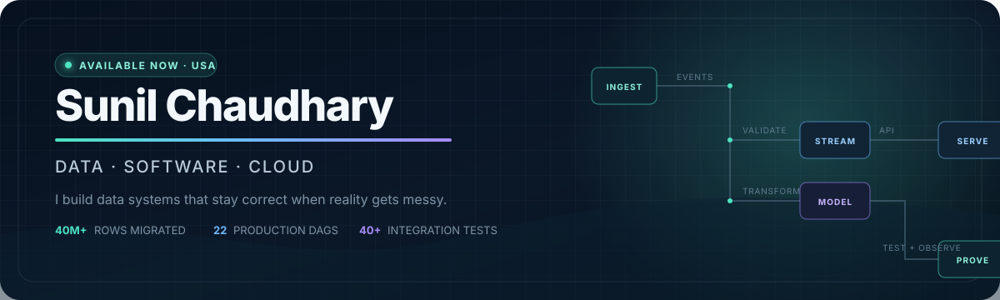

<div align="center">
  <a href="https://sunilchaudhary.me">
    
  </a>
</div>

<div align="center">
  <a href="https://sunilchaudhary.me"></a>
  <a href="https://www.linkedin.com/in/sunil-chaudhary-neu/"></a>
  <a href="mailto:chaudhary.sun@northeastern.edu"></a>
  <a href="https://sunilchaudhary.me/Sunil-Chaudhary-Resume.pdf"></a>
</div>

## Engineering for the failure path

I am a data, software, and cloud engineer who likes the part after the happy-path demo: late events, schema drift, duplicate messages, partial outages, and the evidence that proves a recovery actually worked.

Across **3 years at Avanade (Accenture)** and graduate work at Northeastern, I have built and improved data platforms, backend services, and cloud delivery systems. I recently completed an **M.S. in Information Systems at Northeastern University (August 2026)** and am **available now** for opportunities across the United States—happy to relocate where the right engineering problem takes me.

| 40M+ | 90 → 35 min | 22 @ 99% | 40+ |
|:---:|:---:|:---:|:---:|
| rows migrated | ETL runtime | production DAGs | integration tests |

## Systems I am building

<table>
  <tr>
    <td width="50%" valign="top">
      <h3><a href="https://github.com/sunil8446/tidemark">Tidemark</a></h3>
      <p><strong>Real-time market surveillance with measurable correctness.</strong></p>
      <p>Go ingestion from Coinbase and Kraken, gap repair, Redpanda, Flink exactly-once processing, Iceberg, ClickHouse, dbt marts, detectors, and an evidence-grounded AI investigator.</p>
      <p><code>Go</code> <code>Redpanda</code> <code>Flink</code> <code>Iceberg</code> <code>dbt</code></p>
      <p><strong>Proof:</strong> 864,522 / 864,522 trades accounted for in a 24-hour run; zero missing and zero duplicates after audit.</p>
    </td>
    <td width="50%" valign="top">
      <h3><a href="https://github.com/sunil8446/stripe-credit-fraud-analytics">Fraud Analytics Platform</a></h3>
      <p><strong>A local-first, cloud-ready analytics product.</strong></p>
      <p>Layered dbt models, tested business rules, temporal ML evaluation, explainable risk scoring, drift monitoring, policy simulation, and a FastAPI scoring surface.</p>
      <p><code>Python</code> <code>dbt</code> <code>DuckDB</code> <code>BigQuery</code> <code>FastAPI</code></p>
      <p><strong>Design choice:</strong> free, reproducible local development with an intentional BigQuery production path.</p>
    </td>
  </tr>
  <tr>
    <td width="50%" valign="top">
      <h3><a href="https://github.com/sunil8446/reqwatch">Reqwatch</a></h3>
      <p><strong>Job-market intelligence from public ATS data.</strong></p>
      <p>Incremental ingestion across Greenhouse, Lever, and Ashby with content hashing, SCD2 history, idempotent reruns, freshness checks, dbt marts, and a typed API.</p>
      <p><code>Python</code> <code>PostgreSQL</code> <code>dbt</code> <code>GitHub Actions</code></p>
      <p><strong>Current state:</strong> 98 of 150 seed boards verified; end-to-end double-run integration tests prove idempotency.</p>
    </td>
    <td width="50%" valign="top">
      <h3><a href="https://sunilchaudhary.me">Interactive Portfolio</a></h3>
      <p><strong>The short version of my engineering story.</strong></p>
      <p>Experience, selected systems, quantified outcomes, and an interactive 3D architecture scene—built to help a hiring team find the signal quickly.</p>
      <p><code>JavaScript</code> <code>CSS</code> <code>Three.js</code> <code>GitHub Pages</code></p>
      <p><a href="https://sunilchaudhary.me">Open portfolio →</a></p>
    </td>
  </tr>
</table>

## My working set

| Data systems | Software engineering | Cloud & delivery |
|---|---|---|
| Python, SQL, dbt, Airflow | Go, Java, FastAPI, REST | Azure, AWS, GCP |
| Kafka / Redpanda, Flink | Pytest, integration testing | Docker, Kubernetes / GKE |
| PostgreSQL, BigQuery, DuckDB | data contracts, observability | Terraform, GitHub Actions |

## What I optimize for

```text
correctness you can audit  >  impressive claims you cannot reproduce
recovery you have tested   >  reliability you merely assume
clear trade-offs           >  architecture by buzzword
```

<div align="center">
  <p><strong>Open to data engineering, backend/platform engineering, and cloud engineering roles.</strong></p>
  <p>Boston-based · available immediately · open to relocation across the U.S.</p>
  <p>
    <a href="mailto:chaudhary.sun@northeastern.edu">chaudhary.sun@northeastern.edu</a>
    &nbsp;·&nbsp;
    <a href="https://www.linkedin.com/in/sunil-chaudhary-neu/">LinkedIn</a>
    &nbsp;·&nbsp;
    <a href="https://sunilchaudhary.me">Portfolio</a>
  </p>
</div>
